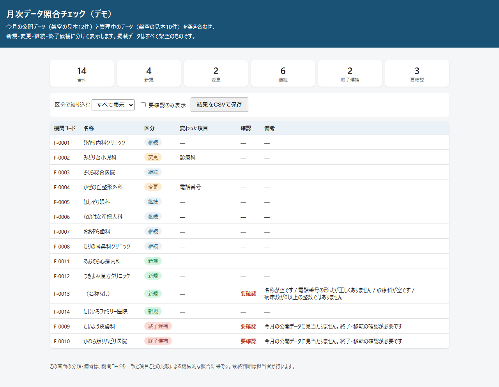
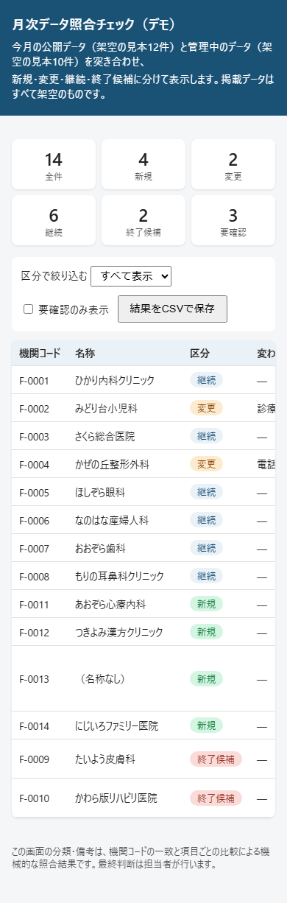

# 月次データ照合チェック（POC）

毎月更新される公開データと管理中のデータを突き合わせ、新規・変更・継続・終了候補に分類し、指定フォーマットの出力行に整形する処理を確かめるPOCです。データはすべて架空の見本です。外部サービス・外部APIは呼びません。

## このPOCで確かめたこと

- 今月分（架空12件）と管理中データ（架空10件）を機関コードで突き合わせて新規・変更・継続・終了候補に分類する（新規4件、変更2件、継続6件、終了候補2件）。
- 変更ありの行について変わった項目名を列挙する（診療科の追加1件、電話番号の変更1件）。
- 必須項目の欠けや形式の誤りがある行に要確認を付ける（名称・電話・診療科・病床数に不備がある1件と、公開データに見当たらない2件の計3件）。
- 照合結果を指定フォーマットの出力行（コード・名称・所在地・電話・診療科・区分・変更項目・要確認・備考）に整形する。
- 全候補ぶんの結果を重複なく返す（14件）。
- 画面を開いた直後に分類結果の一覧と件数が見え、区分での絞り込みと結果のCSV保存ができる。

## 作っていない範囲

- 公開データの自動取得
- データベースへの書き込み更新
- Excelファイルの入出力

## 次の進め方

- 実際の公開データの項目に合わせて比較項目と入力チェックの条件を調整する。
- 出力行の列構成を発注側の指定フォーマットに合わせて調整する。
- Excelファイル（.xlsx）の読み書きを追加し、手作業の表と行き来できるようにする。

## 動かし方

- 画面：`docs/index.html` をブラウザで開く。
- テスト：`npm install` 後に `npm test` を実行する。
